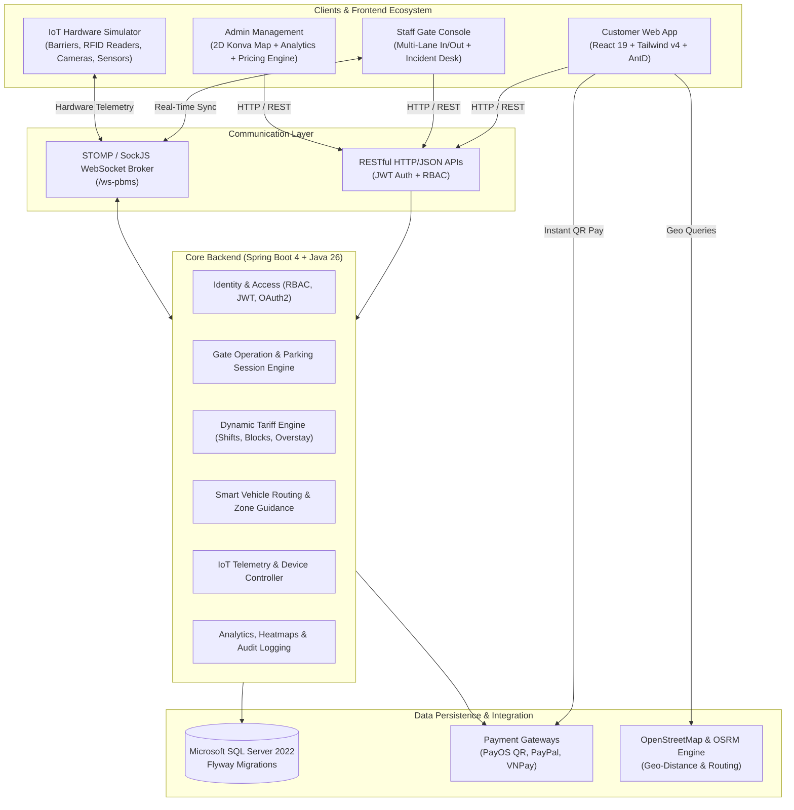

# 🚗 PBMS - Smart Parking Building Management System

<div align="center">

[](https://openjdk.org/)
[](https://spring.io/projects/spring-boot)
[](https://react.dev/)
[](https://www.typescriptlang.org/)
[](https://tailwindcss.com/)
[](https://www.microsoft.com/sql-server/)
[](https://stomp.github.io/)
[](https://playwright.dev/)
[](https://opensource.org/licenses/MIT)

**An enterprise-grade, touchless smart parking management ecosystem integrating automated barrier gates, ALPR (Automatic License Plate Recognition), real-time IoT hardware telemetry, dynamic multi-tier pricing policies, 2D interactive space maps, and seamless cashless payments.**

[Live Repository](https://github.com/NguyenHuyHoangTech/ParkingManagement) • [Key Features](#-key-features) • [System Architecture](#-system-architecture) • [Tech Stack](#-technology-stack) • [Setup Guide](#-installation--setup-guide) • [Commit History](./COMMIT_HISTORY.md)

</div>

---

## 📌 Executive Summary

Traditional parking management systems in high-density urban commercial buildings suffer from manual ticket bottlenecks, lost paper vouchers, inaccurate slot tracking, opaque tariff disputes, and prolonged queue times at entry and exit gates.

**PBMS (Parking Building Management System)** is a comprehensive end-to-end platform engineered to deliver a seamless, touchless smart parking experience:
- **For Drivers & Customers:** Instant vacancy tracking, dynamic GPS route distance calculation, reservation pre-booking with spot locking, monthly pass subscriptions, and instant cashless QR payments (PayOS, VNPay, PayPal).
- **For Gate Operators & Staff:** Ultra-responsive multi-lane Gate In/Out console, sub-second ALPR plate recognition, automatic tariff calculation with grace period & overtime logic, electronic barrier control, and real-time incident resolution.
- **For Building Managers & Admins:** Interactive 2D canvas slot layout editor (React Konva), real-time occupancy heatmaps, granular multi-tier shift pricing configurations, smart vehicle routing algorithms, and comprehensive financial audit trails.
- **For Hardware Verification:** Built-in IoT hardware simulator emulating barrier gates, RFID card readers, ultrasonic bay sensors, and optical cameras over WebSockets.

---

## 🏛 System Architecture

The PBMS platform follows a decoupled, multi-tier microservice-inspired architecture designed for high throughput, sub-second real-time responsiveness, and modular maintainability:



---

## 🚀 Key Features

### 1. 🚗 Customer Touchless Experience Portal
- **Real-Time Slot Vacancy**: Instant visibility of remaining vacant spots categorized by vehicle type (Car, Motorbike, E-Bike).
- **Smart Pre-Booking & Bay Reservation**: Reserve a designated parking slot prior to departure; the engine locks the capacity quota and guarantees availability.
- **Dynamic Geo-Location & Routing Distance**: Integrated with OpenStreetMap Nominatim and OSRM driving engine to calculate real-time driving distance, estimated travel time from user GPS, and one-tap turn-by-turn navigation via Google Maps.
- **Cashless Instant QR Settlement**: Automated bill generation with dynamic QR code (PayOS VietQR / PayPal) verified instantly via WebSocket payment hooks.
- **Monthly Digital Passes**: Online application and renewal for recurring parkers with automatic plate binding and discount schemes.

### 2. 🛡 Staff Gate In & Gate Out Console
- **Multi-Lane Dual-Gate Control**: Independent, high-frequency operator console managing simultaneous Inbound and Outbound traffic lanes.
- **High-Speed ALPR (Automatic License Plate Recognition)**: Optical license plate detection with manual override, confidence score, and snapshot archiving.
- **Dual Verification (RFID + Plate)**: Fallback physical RFID card tap verification linked with real-time card inventory.
- **Instant Tariff Breakdown & Preview**: Automated multi-shift tariff computation detailing base blocks, progressive duration increments, night shifts, and discounts.
- **Exception & Incident Management**: On-the-spot ticketing for lost cards, damaged tags, license mismatch, and barrier override logging with manager authorization.

### 3. 📊 Executive & Facility Management
- **Interactive 2D Space Map (React Konva)**: Drag-and-drop floorplan visualizer rendering slot coordinates, zone boundaries, barrier locations, and live occupancy status.
- **Smart Vehicle Routing Rules**: Configurable rule engine that analyzes zone capacity thresholds and dimensions to recommend optimal parking zones via LED boards.
- **Dynamic Pricing Engine**: Flexible configuration of time-based shifts (Day, Night, Weekend), progressive block intervals (First 2 hours, next 30-min increments), and penalty multipliers.
- **Revenue & Operational Analytics**: Interactive Recharts dashboards tracking occupancy turnover rates, revenue by payment gateway, peak traffic hours, and audit logs.

### 4. 🕹️ IoT Hardware Simulator
- Full software-based emulation of physical garage hardware components:
  - Motorized boom barriers (Open, Close, Interrupted, Safety loop detection).
  - RFID contactless readers (UID scanning, validation, card assignment).
  - Bay-level ultrasonic sensors (Occupied / Vacant pulse telemetry).
  - Optical camera triggers with snapshot payload streaming.

---

## 💻 Technology Stack

| Layer | Technologies | Purpose |
| :--- | :--- | :--- |
| **Backend Core** | **Java 26**, **Spring Boot 4.1.0** | High-performance enterprise REST API and event processing service |
| **Persistence & ORM** | **Spring Data JPA**, **Hibernate**, **Flyway** | Object-relational mapping with automated versioned schema migrations |
| **Database** | **Microsoft SQL Server 2022** | Relational data persistence with strict foreign key constraints & indexing |
| **Security & Auth** | **Spring Security 6**, **JWT (jjwt)**, **Google OAuth2** | Stateless authentication, role-based authorization (RBAC), and social SSO |
| **Real-time Messaging** | **Spring WebSocket**, **STOMP**, **SockJS** | Low-latency bi-directional messaging between IoT, gates, and client UIs |
| **Frontend Core** | **React 19.2**, **TypeScript 5**, **Vite 8** | Modern reactive client architecture with instant Hot Module Replacement |
| **Styling & UI Kit** | **TailwindCSS v4**, **Ant Design 6** | Sleek responsive design, accessible components, and soft dark/light themes |
| **Interactive Canvas** | **React Konva**, **Konva.js** | High-performance HTML5 Canvas 2D parking lot visualizer |
| **State & Data Fetching**| **TanStack React Query v5**, **Zustand** | Asynchronous server-state caching, background revalidation, and client stores |
| **Payment Gateways** | **PayOS (VietQR)**, **PayPal SDK** | Automated cashless payments and real-time webhook callback processing |
| **Maps & Routing** | **OpenStreetMap Nominatim**, **OSRM API** | Geocoding, distance calculation, driving duration estimation |
| **E2E Testing** | **Playwright**, **Video Reporter** | Automated end-to-end user journey simulation and browser regression testing |

---

## 📂 Project Directory Structure

```
ParkingManagement/
├── pbms-be/                    # Spring Boot Backend Service (Java 26)
│   ├── src/main/java/com/pbms/ # Clean Architecture modules (identity, operation, pricing, etc.)
│   ├── src/main/resources/     # Application configurations, Flyway SQL migrations
│   ├── .env.example            # Environment template for backend
│   └── pom.xml                 # Maven build dependencies
├── pbms-fe/                    # Web Application Portal (React 19 + TypeScript)
│   ├── src/core/               # API clients, WebSocket hooks, error boundary, stores
│   ├── src/features/           # Customer, Staff, Manager, and Admin portals
│   ├── .env.example            # Environment template for frontend
│   └── package.json            # Node dependencies and build scripts
├── pbms-iot-simulator/         # Virtual Hardware Emulation Tool (React 19 + Vite)
│   ├── src/                    # Hardware components (Barriers, RFID, Sensors, Cameras)
│   ├── .env.example            # Environment template for simulator
│   └── package.json            # Simulator build configuration
├── pbms-e2e/                   # Playwright E2E Testing Suite
│   ├── tests/                  # End-to-end integration and smoke test specs
│   └── playwright.config.ts    # Browser automation configurations
├── database/                   # Database Schemas & Documentation
│   ├── 0_DATABASE.sql          # Clean database initialization script
│   └── AllOfTable.md           # 24 core domain table specifications
├── 1_Documentation/            # Technical Specifications & Architectural Guides
│   ├── Websocket.md            # In-depth guide to STOMP WebSocket messaging
│   └── Comment_Coding.md       # Coding standards and design patterns
├── .gitignore                  # Production-grade repository exclusions
├── COMMIT_HISTORY.md           # Comprehensive milestone & commit audit trail
└── README.md                   # Flagship project documentation
```

---

## 🗄 Database Domain Model

The PBMS relational database is composed of **24 core domain entities** organized into cohesive operational boundaries:

```
[Users / Roles] ───< [StaffWorkSessions]
      │
      ├───< [Vehicles] ───< [ParkingSessions] ───> [Transactions] ───> [PaymentOrders]
      │                           │                       │
      ├───< [MonthlyTickets]      ├───> [IncidentTickets] └───> [RefundRequests]
      │                           │
      └───< [Reservations] ───────┤
                                  │
[Floors] ───< [Zones] ───< [Slots]┘
                │
                ├───< [RoutingRules]
                ├───< [ZoneHourlyTrends]
                └───< [Gates] ───< [RfidCards]
```

- **Operations:** `parking_sessions`, `incident_tickets`, `staff_work_sessions`, `gates`, `rfid_cards`
- **Infrastructure:** `floors`, `zones`, `slots`, `routing_rules`, `building_profiles`
- **Billing & Finance:** `pricing_policies`, `pricing_shifts`, `pricing_blocks`, `payment_orders`, `transactions`, `refund_requests`
- **Customers & Access:** `users`, `vehicles`, `vehicle_types`, `monthly_tickets`, `reservations`
- **Governance:** `audit_logs`, `system_configs`, `zone_hourly_trends`

---

## ⚡ Installation & Setup Guide

### 1. Prerequisites
- **JDK 26** installed and configured in `JAVA_HOME`.
- **Node.js** (v20+ LTS) and **npm** (v10+).
- **Microsoft SQL Server 2019+** (Developer or Express edition).

---

### 2. Database Initialization

1. Open **SQL Server Management Studio (SSMS)** or Azure Data Studio.
2. Create a new database named `pbms_db`:
   ```sql
   CREATE DATABASE pbms_db;
   ```
3. Run the initialization script located at `database/0_DATABASE.sql` (or restore `pbms.bak` directly via SSMS Task -> Restore Database).

---

### 3. Backend Setup (`pbms-be`)

1. Open a terminal in `pbms-be/`:
   ```bash
   cd pbms-be
   ```
2. Create your `.env` configuration file from the template:
   ```bash
   cp .env.example .env
   ```
3. Verify your database credentials in `.env`:
   ```env
   DB_URL=jdbc:sqlserver://localhost:1433;databaseName=pbms_db;encrypt=true;trustServerCertificate=true
   DB_USERNAME=sa
   DB_PASSWORD=your_password
   ```
4. Build and start the backend service:
   ```bash
   # Windows PowerShell / CMD
   .\mvnw.cmd clean spring-boot:run

   # Linux / macOS
   ./mvnw clean spring-boot:run
   ```
5. The API will start on `http://localhost:8080`.

---

### 4. Frontend Setup (`pbms-fe`)

1. Open a terminal in `pbms-fe/`:
   ```bash
   cd pbms-fe
   ```
2. Install dependencies:
   ```bash
   npm install
   ```
3. Start the Vite development server:
   ```bash
   npm run dev
   ```
4. Access the web portal at `http://localhost:5173`.

---

### 5. IoT Simulator Setup (`pbms-iot-simulator`)

1. Open a terminal in `pbms-iot-simulator/`:
   ```bash
   cd pbms-iot-simulator
   ```
2. Install dependencies:
   ```bash
   npm install
   ```
3. Start the simulator:
   ```bash
   npm run dev
   ```
4. Access the hardware simulator at `http://localhost:3001`.

---

## 🧪 Testing & Quality Assurance

PBMS incorporates an automated test strategy covering backend logic, component rendering, and end-to-end browser workflows:

```bash
# 1. Run Backend Unit & Integration Tests
cd pbms-be
./mvnw test

# 2. Run Frontend Type Checking & Production Build
cd pbms-fe
npm run build

# 3. Run Automated Playwright E2E Tests
cd pbms-e2e
npm install
npx playwright test
```

---

## 📜 Commit History & Evolution

For a complete chronological audit of all 67+ project commits, architectural milestones, feature additions, and optimization refactorings, please refer to:
👉 **[Full Commit History & Changelog Guide](./COMMIT_HISTORY.md)**

---

## 👨‍💻 Author & Portfolio

**Nguyen Huy Hoang**
- **GitHub**: [@NguyenHuyHoangTech](https://github.com/NguyenHuyHoangTech)
- **Repository**: [https://github.com/NguyenHuyHoangTech/ParkingManagement](https://github.com/NguyenHuyHoangTech/ParkingManagement)
- **Role**: Lead Full-Stack Architect & Core Developer
- **Domain Focus**: Enterprise Web Applications, Real-Time Systems, IoT Hardware Telemetry, Smart Infrastructure.
